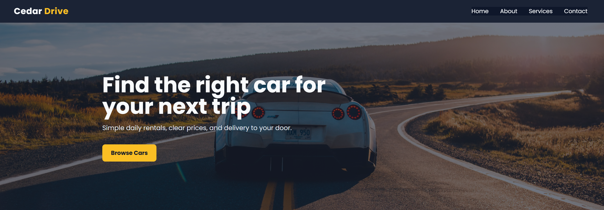
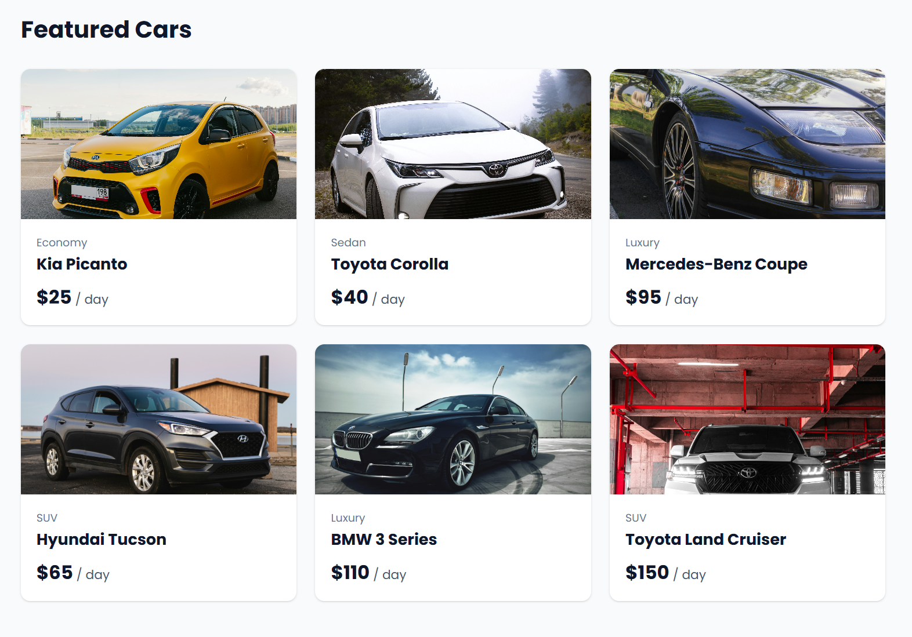
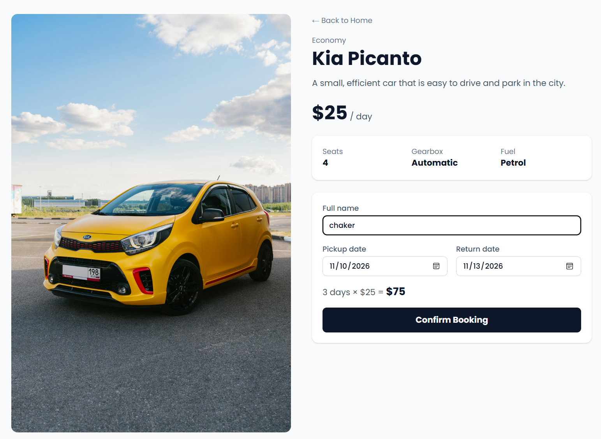
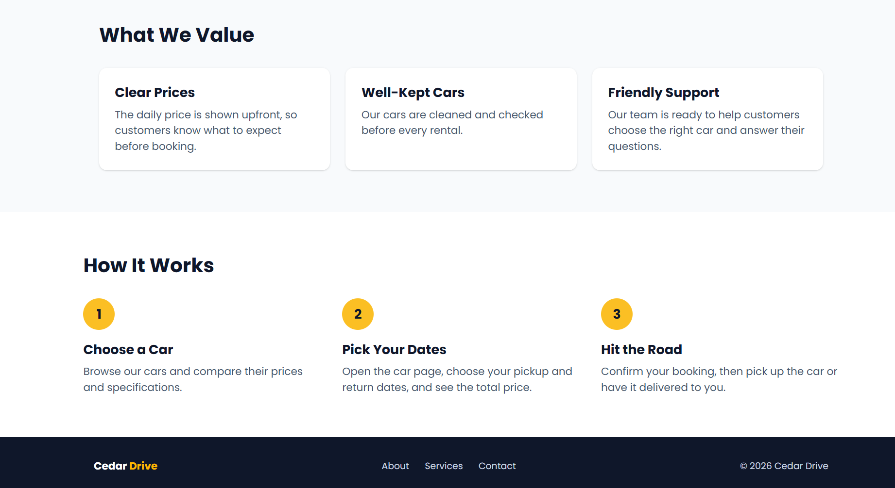
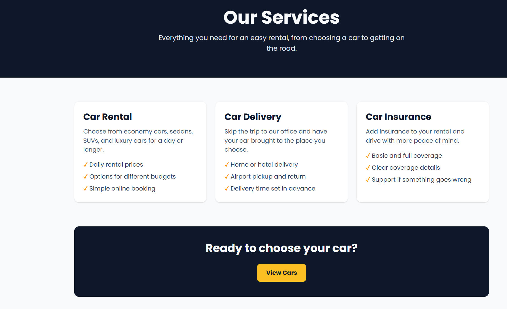
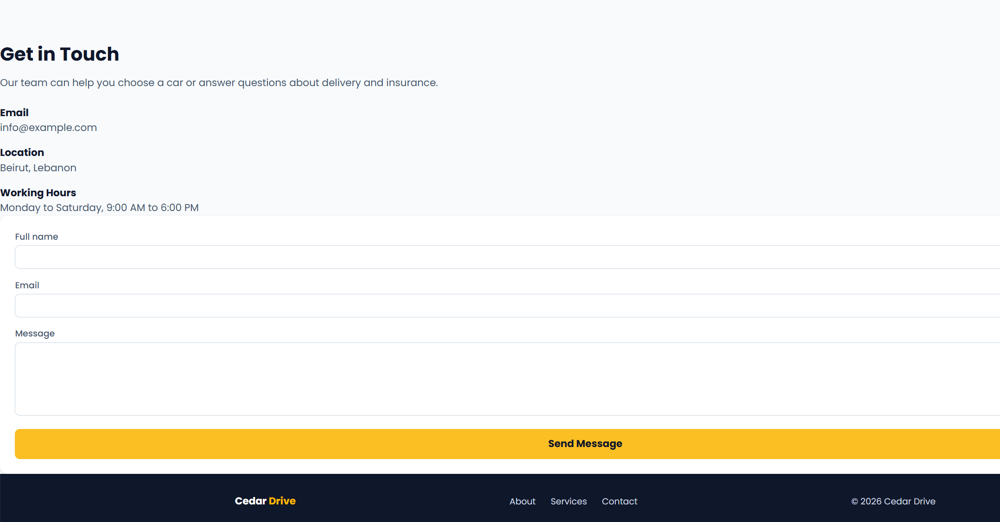
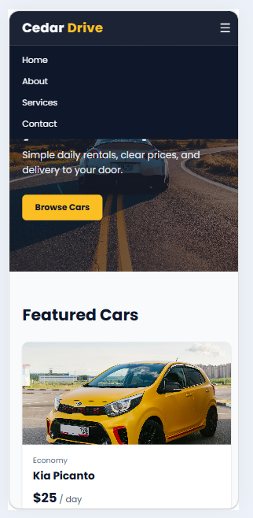

# Cedar Drive – Car Rental Website

Cedar Drive is a responsive car rental website built with React for the CSCI426 Advanced Web Programming course. Users can browse available cars, view the details of each car, calculate the rental price for their chosen dates, and contact the company.

**Live website:** https://spiffy-rugelach-9cd4a9.netlify.app

## Features

- Five pages: Home, About, Services, Contact, and a dynamic Car Details page
- Dynamic routing with React Router: each car has its own page (`/cars/:id`)
- Booking form that calculates the total price based on the selected dates
- Contact form with validation for name, email, and message
- Responsive design that works on desktop, tablet, and mobile
- Mobile navigation menu

## Technologies Used

- React
- Vite
- Tailwind CSS
- React Router
- Git and GitHub
- Netlify

## Setup Instructions

1. Make sure [Node.js](https://nodejs.org) is installed.
2. Clone the repository:

   ```bash
   git clone https://github.com/52330825-cmyk/car-rental.git
   ```

3. Open the project folder:

   ```bash
   cd car-rental
   ```

4. Install the dependencies:

   ```bash
   npm install
   ```

5. Start the development server:

   ```bash
   npm run dev
   ```

6. Open `http://localhost:5173` in the browser.

## Project Structure

```text
car-rental/
├── public/
│   ├── images/          Car and hero images
│   └── _redirects       Netlify routing rule
├── screenshots/         UI screenshots used in this README
└── src/
    ├── components/      Navbar, Footer, CarCard
    ├── data/            Car data
    ├── pages/           Home, About, Services, Contact, CarDetails
    ├── App.jsx          Page routes
    ├── main.jsx         App entry point
    └── index.css        Tailwind setup, colors, and font
```

## Screenshots

### Home


### Featured Cars


### Car Details and Booking


### About



### Services


### Contact


### Mobile View


## Notes

Cedar Drive is a fictional company created for this project. The car prices, company statistics, and contact details are sample data. There is no backend, so bookings and contact messages are not saved or sent.

## Image Credits

All car images are from [Unsplash](https://unsplash.com) and are used under the Unsplash License.

| Image | Photographer | Source |
|---|---|---|
| hero.jpg | Erik Mclean | [Unsplash](https://unsplash.com/photos/silver-sports-coupe-on-asphalt-road-ZRns2R5azu0) |
| car-1.jpg | Michail Dementiev | [Unsplash](https://unsplash.com/photos/yellow-honda-sedan-on-road-during-daytime-6YzbCQw8Lsw) |
| car-2.jpg | Bestami Sarikaya | [Unsplash](https://unsplash.com/photos/a-white-car-parked-on-the-side-of-a-road-DwNmXuRb1Tk) |
| car-3.jpg | Kevin Woblick | [Unsplash](https://unsplash.com/photos/black-mercedes-benz-coupe-on-gray-concrete-pavement-njwcDPhR0wQ) |
| car-4.jpg | Duncan Winslow | [Unsplash](https://unsplash.com/photos/black-hyundai-vehicle-beside-beige-wooden-house-at-daytime-Xs69Y3k1ru4) |
| car-5.jpg | Arteum.ro | [Unsplash](https://unsplash.com/photos/black-bmw-sedan-KiTalJFRkcg) |
| car-6.jpg | Abolfazl Raghebi | [Unsplash](https://unsplash.com/photos/a-white-suv-parked-in-a-parking-garage-qdq1ptUnYaw) |

## Author

Chaker – CSCI426 Advanced Web Programming, Fall 2026